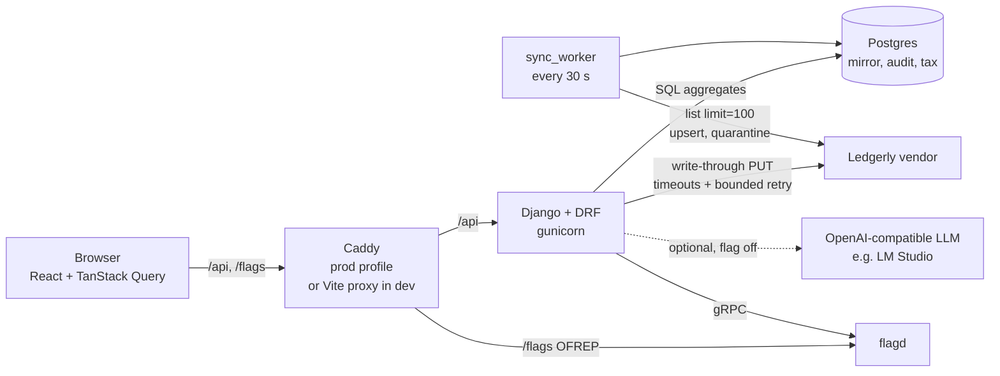

# Member Money Ledger

A ledger for self-employed members: see where money goes, recategorize transactions (saved
to the bank-data vendor, Ledgerly), and know how much to set aside for quarterly taxes.

Start with `PROMPT.md` (the brief) and `NOTES.md` (what we built, why, and what's next).

## Quick start

**Prerequisites:** Docker with Compose v2 and `make`. Node 24+ on the host only for E2E and
Lighthouse.

```sh
make up          # docker compose up --build (dev, hot reload)
```

1. Open **http://localhost:5173**.
2. Sign in as **member@example.com** / **demo-password-2026** (a dev-only seeded member).
3. The app opens on the current month. The vendor's sample data is October 2026, so click
   **Jump to October 2026**, or load three months of demo data:

```sh
make reset-demo SEED=1   # restart the vendor, clear the mirror, POST ~60 validated demo rows, sync
```

| Service | URL | What |
|---|---|---|
| web (dev) | http://localhost:5173 | React + TypeScript (Vite), hot reload |
| api | http://localhost:8000/api/health | Django + DRF. Swagger UI at `/api/docs` (dev only) |
| web (prod profile) | http://localhost:8081 | `make prod`: built app behind Caddy, gunicorn API, CSP and security headers |
| vendor | http://localhost:8080/v1/transactions | Ledgerly stand-in (**never edit `vendor/`**) |
| flagd | http://localhost:8016 | Feature flags (OpenFeature, OFREP) |
| db | localhost:5433 | Postgres, user/password/db `ledger` |

`make help` lists every command. Once the images are built, everything runs offline.
On Windows, run the `docker compose` lines from the Makefile directly in PowerShell.

## Architecture



- **Reads come from a Postgres mirror of Ledgerly.** Three things keep it fresh: a worker
  every 30 s, a request-path fallback when the data is more than 60 s old (behind an advisory
  lock), and the Refresh button. The vendor has no filters and an offset cursor, so proxying
  it live would be slow and fragile (ADR 0001).
- **Writes go to Ledgerly first.** Only the vendor's response row is stored. If the vendor
  fails, nothing changes locally and the member gets a plain-English error.
- **When the mirror and Ledgerly disagree, the vendor wins** on every full sync, except for
  writes made during that sync (ADR 0019). Malformed vendor rows are quarantined, not dropped
  (ADR 0020).
- **Every trap the data sets** (refunds, pending, uncategorized, local dates, transfers, offset
  pagination, a vendor that validates nothing…) is in `docs/traps.md`, with its handling and
  its test.

## API

All responses are JSON. Errors always use `{"error": {"code", "message", "request_id"}}`.
Writes need `Content-Type: application/json` and, when signed in, `X-CSRFToken`. The OpenAPI
schema is `api/schema.yml`, and the TypeScript types are generated from it (`make types`).

| Method | Path | What |
|---|---|---|
| GET | `/api/transactions` | List. Filters: `category` (repeatable, `uncategorized`), `from`, `to`, `status`, `account`, `q`. Keyset `cursor` and `limit` (≤ 200). Returns `{results, next_cursor, synced_at}` |
| GET | `/api/transactions/{id}` | One transaction |
| PATCH | `/api/transactions/{id}` | Recategorize: `{category, expected_updated_at}`. 409 `stale`, 502 `vendor_unavailable` |
| GET | `/api/transactions/{id}/history` | Audit history (member, sync and rule changes) |
| GET | `/api/summary?month=YYYY-MM` | Income, spend, net, pending, uncategorized, spend by category. ETag/304 |
| GET | `/api/categories` | Our category list (Schedule C line, deductible fraction) |
| POST | `/api/sync` · GET `/api/sync/status` | Refresh now · last sync, state (`ok`/`running`/`vendor_down`), quarantined rows |
| GET | `/api/tax/set-aside?quarter=&today=` | Set-aside estimate for an IRS period |
| PUT | `/api/tax/settings` | `{rate}`, 0–0.6 |
| POST | `/api/tax/set-aside-marks` | `{quarter, amount_cents[, reason]}`: "Mark as set aside" |
| GET | `/api/flags` | Feature flags as evaluated by the server |
| GET/POST | `/api/auth/csrf` · `login` · `logout` · `me` | Session auth, 15-minute idle timeout |
| GET | `/api/health` | DB and vendor status. 200 with `degraded`, never a 500 when the vendor is down |
| GET | `/api/schema` · `/api/docs` | OpenAPI and Swagger UI (dev only) |

## Testing

| Layer | Command | What |
|---|---|---|
| API unit/integration | `make test-api` | pytest-django: money math, sync against a fake vendor that reproduces every vendor quirk, vendor client, API, auth, tax |
| Web unit | `make test-web` | Vitest + Testing Library: dates (pinned to `America/Los_Angeles`), money, URL filters, optimistic recategorize races, components |
| E2E + a11y | `make e2e` | Playwright + axe (WCAG 2.2 AA) against the prod profile. Restarts the vendor and resets the mirror first |
| Lighthouse | `make lighthouse` | LHCI on the prod profile, asserting ≥ 0.95 on performance, accessibility, best practices and SEO |
| Everything | `make verify` | Lint (Ruff, Biome), types (mypy, tsc), unit tests, schema/types drift |

Git hooks (lefthook): pre-commit runs lint and types on staged files, commit-msg runs
commitlint, and pre-push runs the tests and audits. CI (`.github/workflows/ci.yml`) runs every
layer.

## Feature flags

OpenFeature with a flagd container reading `flags/flags.json`. The server evaluates flags and
enforces them; the web app only mirrors them for display. When flagd is down, each flag falls
back to its default in code (auth stays **on**). Moving to LaunchDarkly is a provider swap
(ADR 0008).

| Flag | Default | Controls |
|---|---|---|
| `tax-set-aside` | on | The tax set-aside card and API |
| `auth-required` | on | Session login. Off = single-member demo without sign-in |
| `merchant-rules` | off | "Apply to N other Figma transactions?" prompt + rules on sync |
| `category-suggestions` | off | AI suggestion chip (also needs `LLM_BASE_URL` + `LLM_MODEL`) |

To toggle a flag, edit `defaultVariant` in `flags/flags.json`. flagd reloads the file on
change; no restart is needed.

## Known limitations and security risks not addressed

See `docs/security.md` for the threat model.

- **Single tenant.** One seeded member. Queries go through a member scope, but transactions
  have no member foreign key yet (the vendor has no concept of a member).
- **Last write wins at the vendor.** Ledgerly has no ETag, and its `updated_at` has one-second
  resolution. We detect stale edits through the mirror and a vendor GET before each PUT, but
  two edits in the same second are indistinguishable (one documented xfail test).
- **The vendor is unauthenticated** and published on `:8080` in dev. Anyone on the machine can
  change data, and its restart resets data and **reuses ids** (handled, but audit history is
  cut at a "replaced" event).
- **The prod profile serves plain HTTP**, so secure cookies are off there. Put TLS in front and
  set `DJANGO_SECURE_COOKIES=1`.
- **No MFA, no password reset, and no account lockout beyond rate limits.**
- **The audit log is append-only in the application, not enforced by the database.**
- **The tax set-aside is an estimate, not tax advice.** It applies a flat rate to profit. It
  doesn't include state tax, the QBI deduction, or safe-harbor rules.

## Stretch goals / TODO

- [x] **Claude Design handback adopted as the spec.** `web/src/styles/handback.css` is the
  handback's `base.css`, and the markup follows `screens/*.html`. Done:
  - Overview, including the mobile filter sheet.
  - Detail drawer: radio-grid picker, editable description, `?txn=` deep link.
  - Login and session dialog.
  - Empty, error and offline states.
  - Inline rule prompt and stale-edit note.

  Remaining small gaps:
  - Pending-by-category and "N deposits" captions (need summary API fields).
  - The cloud-off icon.
  - Arrow-key navigation in the account menu.
  - Suggestion chip "Thinking…" state.
  - The mock's "posted at $X (was $Y)" detail on stale edits.
  - The product name stays **Ledger**; the mockups use the client's brand.
- [ ] The vendor-down E2E is timing-sensitive: the sync worker can hold the sync lock while it
  waits on the stopped vendor. It passed on rerun; give it a deterministic wait.
- [x] Merchant rules (`merchant-rules`, off by default): turn it on in `flags/flags.json` to demo
- [x] AI category suggestions (`category-suggestions` plus `LLM_BASE_URL`/`LLM_MODEL`): built and
  unit-tested. **The local eval is still to run.** LM Studio wasn't serving during the build,
  so it scored 0/15 on timeouts. With the model loaded, run
  `docker compose exec -e LLM_BASE_URL=http://host.docker.internal:1234/v1 -e LLM_MODEL=google/gemma-4-26b-a4b api python manage.py eval_suggestions --no-cache`
- [ ] Reconcile deletions visibly ("this transaction left your bank feed")
- [ ] Run Cloudflare's security-audit skill:
      `npx skills add https://github.com/cloudflare/security-audit-skill --skill security-audit`
- [ ] A shared cache for throttles across hosts (Redis), TLS in the prod profile, and a member
      foreign key on transactions
- [ ] `reset_mirror` doesn't clear set-aside marks (append-only); E2E asserts relative values
- [ ] Instrument the set-aside events listed in `NOTES.md` and run the holdout

## More

- `AGENTS.md`: layout, commands and the product rules every change must respect
- `docs/README.md`: how this was built (the process log, the plan, roles), decisions
  (`docs/decisions/`), the trap register (`docs/traps.md`), the AI log (`docs/ai-log.md`) and
  the security model (`docs/security.md`)
